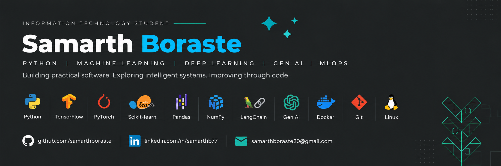

<div align="center">
  

  <h1>Samarth Boraste</h1>
  <p><code>Information Technology</code> · <code>Python</code> · <code>Machine Learning</code></p>

  <p>Building practical software. Exploring intelligent systems. Improving through code.</p>

  <a href="https://www.linkedin.com/in/samarthb77/">
    
  </a>
  <a href="https://github.com/samarthboraste">
    
  </a>
  <a href="https://github.com/samarthboraste/walmart-sales-forecasting">
    
  </a>
</div>

---

```bash
samarth@dev:~$ whoami
Python developer | ML learner | Problem solver
```

## `>_` Current Focus

- Building machine learning and data analysis projects.
- Learning model evaluation and deployment.
- Strengthening DSA, SQL, and software development fundamentals.

## `>_` Tech Stack

<h2 align="left">Tech Stack</h2>

<p align="left">
  
  
  
  
  
  
  
  
  
</p>
## `>_` Featured Projects

<table>
  <tr>
    <td width="50%">
      <h3>Walmart Sales Forecasting</h3>
      <p>Time-series analysis of weekly retail sales, seasonal patterns, and forecasting model evaluation.</p>
      <a href="https://github.com/samarthboraste/walmart-sales-forecasting">View Repository →</a>
    </td>
    <td width="50%">
      <h3>Customer Churn Prediction</h3>
      <p>Customer churn analysis and prediction using exploratory data analysis and machine learning.</p>
      <a href="https://github.com/samarthboraste">Explore Projects →</a>
    </td>
  </tr>
  <tr>
    <td colspan="2">
      <h3>Netflix Movie Recommender</h3>
      <p>A recommendation system using collaborative filtering on the Netflix Prize dataset.</p>
      <a href="https://github.com/samarthboraste">Explore Projects →</a>
    </td>
  </tr>
</table>

## `>_` GitHub Stats

<div align="center">
  
  
</div>

---

<div align="center">
  <code>Build. Learn. Improve. Repeat.</code>
</div>
